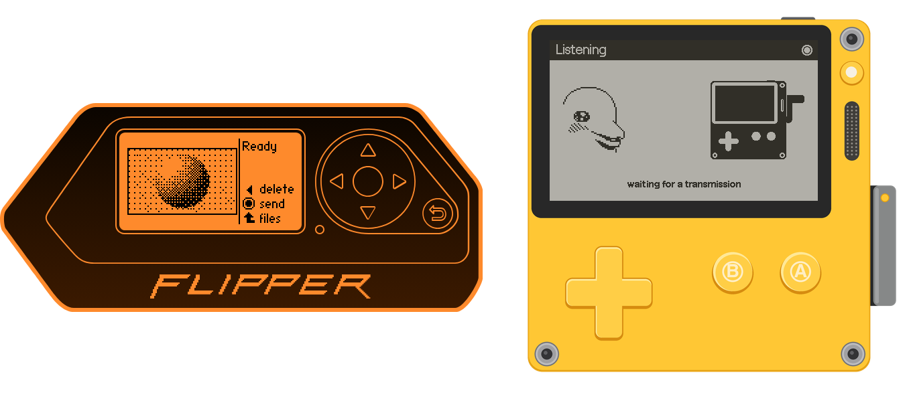

# SFTV Web: Slow Flipper TV in a browser

SFTV Web is the transmitter and the receiver of Slow Flipper TV in a browser. The transmitter
sends pictures and notes to a Playdate running [SFTV RX](https://github.com/Negenii/sftv-playdate),
so you can try it without a Flipper. The receiver shows what a Flipper Zero running
[SFTV TX](https://github.com/Negenii/sftv-flipper) sends, so you can try it without a Playdate.
Both talk near-ultrasound (17–21 kHz) and work with the devices as they are.

Open it at [negenii.github.io/sftv-web](https://negenii.github.io/sftv-web/).

## Getting started

To send, open Flipper · Send, load a picture and press Send, or type a note and press Send note. Keep the speaker
close to the receiver, 3–10 cm. Many laptop and phone speakers barely play 17–21 kHz: if nothing
arrives, try headphones laid next to the receiver.

To receive, open Playdate · Receive and allow the microphone.

The picture comes in line by line while it plays. It comes in slowly: that's why it's a slow TV.

## Credits and licenses

© 2026 negenii. The code is released under the GNU General Public License v3.0 (see `LICENSE`).
Some assets carry their own terms:

- The SFTV-* fonts are drawn from Figtree by The Figtree Project Authors, SIL Open Font License
  1.1 (`pd-src/fonts/OFL-Figtree.txt`).
- The notes font (`Notes-14`) is generated from HaxrCorp 4089 by sahwar, CC BY-SA 3.0.
- `assets/flipper.svg` comes from qFlipper (GPL-3.0).
- Dolphin art comes from the Flipper Zero firmware (GPL-3.0).
- The Playdate body is drawn for this project from simple shapes.
- The Buy Me a Coffee button is their brand asset, used to link to the support page.

If you like it, you can buy me a coffee:

